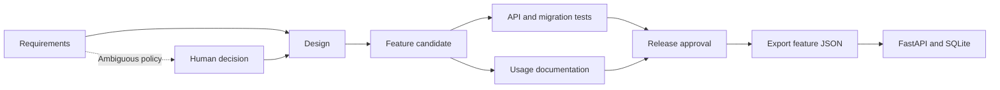

# Agentic URL Shortener

A local FastAPI service and a reviewable delivery workflow. The runner takes a scenario through requirements, design, candidate generation, parallel validation, and a human release-readiness gate.

## Quick start

Use Python 3.13 and SQLite 3.35 or newer. The pinned dependencies were verified with Python 3.13.

```sh
python3.13 -m venv .venv
source .venv/bin/activate
python -m pip install -r requirements.txt
python -m unittest discover -s url_shortener/tests -v
python -m url_shortener.service
```

Open [interactive API docs](http://127.0.0.1:8000/docs) and try `POST /links` with `{"url":"https://example.com"}`. Use the returned path to redirect and `GET /links/{code}/stats` to read the count. The default database is `links.sqlite3`.

## Architecture



The runner persists artifact lineage, source hashes, stage results, decisions and approvals in SQLite. An upstream revision creates a replacement run and invalidates the earlier approval path. The service applies a candidate when an operator explicitly supplies its feature file.

## Review the three scenarios

The deterministic mode runs without a model installation. Use a new workflow database for a fresh demo.

| Scenario | Command | Expected evidence |
|---|---|---|
| Greenfield | `python -m url_shortener.agentic run greenfield --model demo` | Baseline link creation, redirect, and aggregate stats pass validation. |
| Brownfield | `python -m url_shortener.agentic run brownfield --model demo` | TTL validation, 410 for expired redirects, and an additive migration that preserves old links. |
| Ambiguous | `python -m url_shortener.agentic run ambiguous --model demo` | A decision checkpoint for “Only count real clicks.” |

For live model execution, start Ollama locally, install the default model with `ollama pull llama3.2:3b`, and omit `--model demo`. Ollama receives scenario and artifact context over loopback. The deterministic mode remains available for repeatable review and recovery from an unavailable model.

Run `python -m url_shortener.agentic status ID` to review any run. Replace `ID` with the printed numeric ID. For the ambiguous scenario, record a policy, then revise again using the replacement ID and `--policy all` to show re-planning.

```sh
python -m url_shortener.agentic revise ID --policy exclude_previews --reviewer "Demo reviewer" --reason "Count repeat visits; exclude marked previews"
python -m url_shortener.agentic approve ID --reviewer "Demo reviewer" --reason "Reviewed the test evidence"
python -m url_shortener.agentic export ID > features.json
python -m url_shortener.service --features features.json --db demo-links.sqlite3 --port 8001
```

Use the latest ID for approval and export. Preview filtering relies on an explicit `preview` token in the `Purpose` or `Sec-Purpose` header. Brownfield candidates accept optional `ttl_seconds` from 1 to 86400.

## Failure and recovery

```sh
python -m url_shortener.agentic run brownfield --model demo --inject-test-failure
python -m url_shortener.agentic revise ID --reviewer "Demo reviewer" --reason "Recover from injected validation fault"
python -m url_shortener.agentic metrics
```

The injected fault triggers one retry, candidate discard, and a safe stop. The revision removes the injected fault and validates a new candidate. Metrics report validation success, retry and rollback counts, and measured latency. Stage recovery time is available when a failed stage subsequently passes in the same run.

The original deterministic delivery runner remains available as `python -m url_shortener.workflow run`. The model-backed runner is the full scenario demo. See [acceptance criteria](url_shortener/requirements.md), [design decisions and limitations](url_shortener/design.md), and [verification evidence](VERIFICATION.md).
